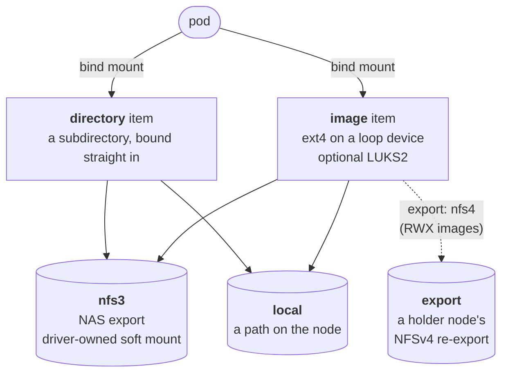
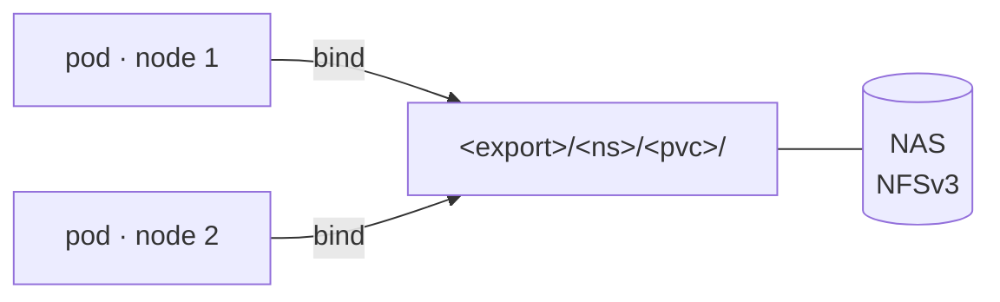
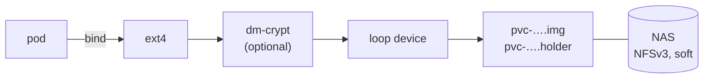
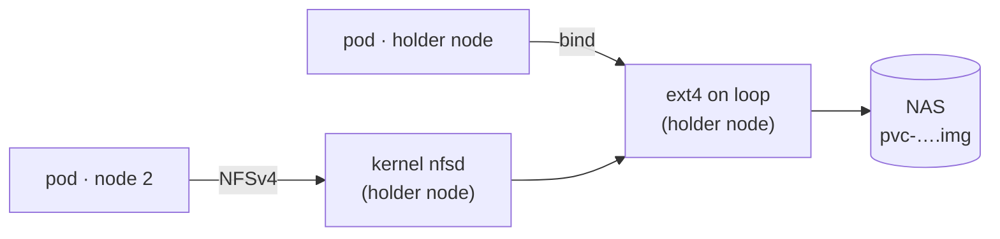
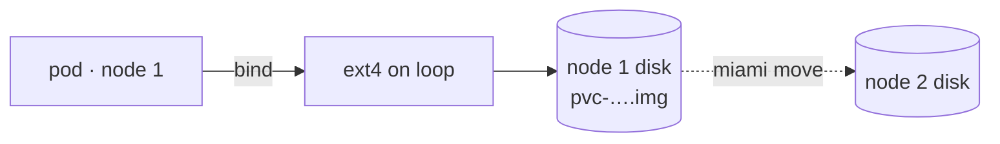

# csi-miami

**MIAMI**: **M**ounting **I**tems **A**cross **M**y **I**nfrastructure. A
Kubernetes CSI driver that turns a NAS that only speaks NFSv3, or a node's
own disk, into volumes that behave like local storage.

> *INT. CLUSTER — NIGHT. A pod has been in `ContainerCreating` for an hour.*
>
> **TECH:** Sir, the pod is falling behind and can not process case files!
>
> *(Sunglasses go on.)*
>
> **LIEUTENANT:** Looks like the evidence is... *mounting.*
>
> **YEEEAAAH**

## Why

NFSv3 on NAS firmware loses mode bits and locking, so git, SQLite and
anything that calls `flock` fall over on it. The fix is layering: ext4 on a
flat file on NFS. Each pod gets a real local filesystem on a loop device
whose backing file lives on the shared export. Where plain shared files are
enough, a pod gets the export's directory straight, with no loop.

## How it fits together

Every volume is an **item** on a **transport**, picked by the StorageClass.



- **Transports** are mounted once per node on the host mount table, so a
  plugin restart changes nothing the kernel sees.
- **The kernel is the truth.** The node agent keeps only intent on disk and
  reconciles mountinfo, `losetup` and dm-crypt toward it, level-triggered.
- **One binary** (`miami node`, `miami controller`, `miami lock`), one
  DaemonSet, one driver name: `miami.csi.greghaskins.com`.

## Modes of mounting

| Mode | Item · transport | Access | Milestone |
|---|---|---|---|
| [Shared directory](#shared-directory) | directory · nfs3 | RWX, many nodes | M1 (building) |
| [Local directory](#local-directory) | directory · local | one node | M1 (building) |
| [Image on the NAS](#image-on-the-nas) | image · nfs3 | RWO, one node at a time | M2 |
| [Shared image](#shared-image) | image · nfs3, `export: nfs4` | RWX through the holder node | M3 |
| [Local image](#local-image) | image · local | one node, movable | M4 |

### Shared directory

A subdirectory of the export, bound into every pod that claims it. NFS
close-to-open semantics; `flock` is node-local, so cross-node locking goes
through `mkdir`, which `miami lock` wraps.



### Local directory

A directory on the node's own disk; what a local-path provisioner gives.
`WaitForFirstConsumer` picks the node and the PV is pinned to it.


### Image on the NAS

The headline mode. A sparse `.img` on the export, loop-mounted as ext4 on
exactly one node. A `.holder` file heartbeats on the NAS's clock; with
`attachRequired` that makes two exclusivity layers, and a dead node is fenced
and taken over unattended.



### Shared image

Two nodes can never loop-mount one ext4, so one node holds the image and
re-exports it over NFSv4. Pods on the holder get local ext4; pods elsewhere
get NFSv4 with real mode bits and real locks. If the holder dies, a client
promotes itself.



### Local image

An image on the node's own disk: a real size cap where root and data share
one disk, optional LUKS2, pinned to the node. `miami move <pvc> --to <node>`
copies it to another node through the same NFSv4 re-export.



**Scratch is a location, not a mode**: any of the above with a transport
path outside the backup set. The StorageClass says whether it's backed up.

## Try it

StorageClasses for both M1 transports are in `deploy/kustomize/examples`.
The base is `deploy/kustomize/base`:

```sh
kubectl apply -k deploy/kustomize/base
kubectl apply -k deploy/kustomize/examples   # edit the server and paths first
```

Design: [architecture brief](docs/design/2026-10-30-architecture-brief.md),
[M1 plan](docs/design/2026-10-31-m1-implementation-plan.md).

## Development

Tools are pinned in `mise.toml`; `mise install` installs them and the git
hooks. Every commit and every push, locally and in CI, goes through
gitleaks secret scanning, and `.claude/settings.json` applies the same scan
to anything an agent publishes to GitHub from this checkout. The gitleaks config is kept outside this repository: export it as
`GITLEAKS_CONFIG_TOML` (the full TOML, normally extending the default rules
with `[extend] useDefault = true`), or as `GITLEAKS_CONFIG_TOML_B64` where a
setting cannot hold a multi-line value, before committing; without it the hooks
refuse to run rather than passing silently. CI reads the same content from
a repository secret of the same name.

## Build

`make check` runs everything CI's `static` and `unit` jobs run (format, vet,
lint, tidy, vulnerability scan and race tests). `make build` builds
`bin/miami`, and `make image` builds the container image for the host
architecture.
